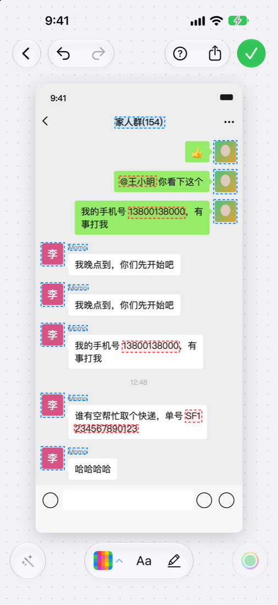
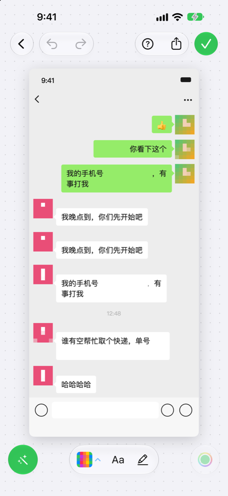
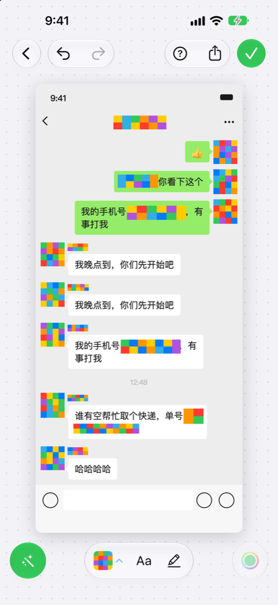
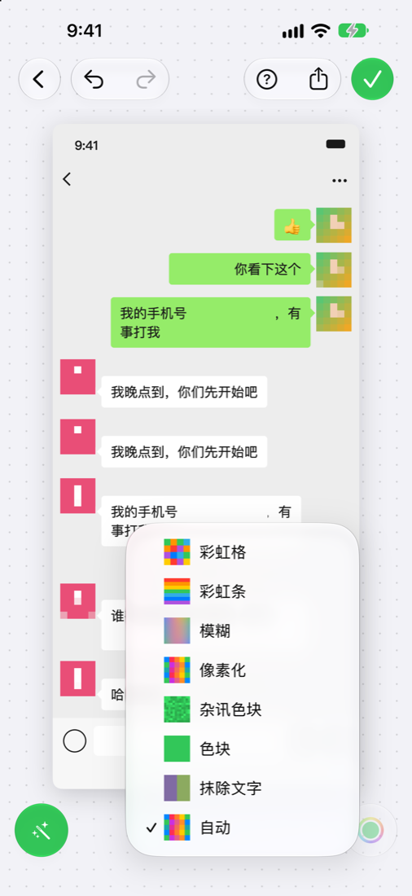
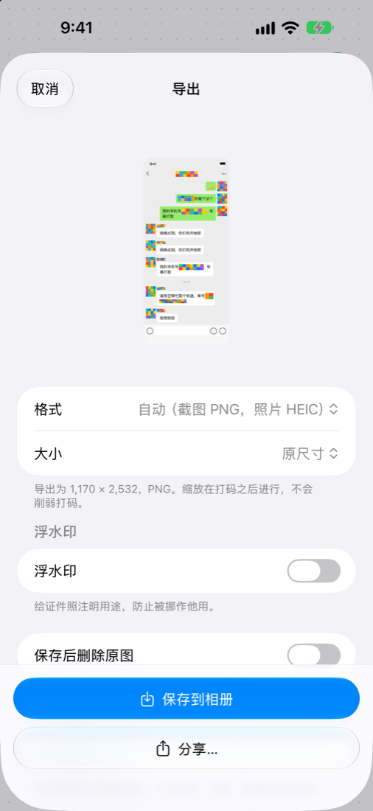
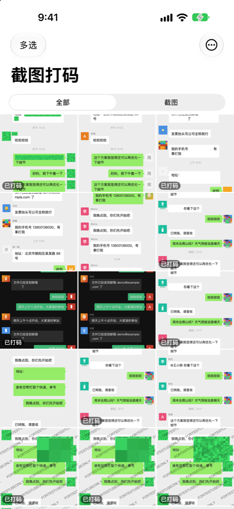

# Mi-Dama · 截图打码

> 截图发出去之前，先让它帮你把不该露的盖住。

一个**完全在手机本地运行**的 iOS 截图打码 App：打开就进入最新的截图，自动找出手机号、身份证、银行卡、地址、人脸、二维码、**聊天头像和昵称**，直接显示打码后的样子。点一下取消，点一下恢复，✓ 保存。

不联网、不上传、不收集任何数据。识别用的是 iOS 自带的 Vision，打码用的是 Core Image。

<table>
  <tr>
    <td align="center"><br><sub>识别到的内容（虚线）</sub></td>
    <td align="center"><br><sub>打开即是打码后的样子</sub></td>
    <td align="center"><br><sub>换一种效果：彩虹格</sub></td>
  </tr>
  <tr>
    <td align="center"><br><sub>8 种效果，菜单里是真实小样</sub></td>
    <td align="center"><br><sub>导出：格式 / 大小 / 水印 / 删原图</sub></td>
    <td align="center"><br><sub>相册，打过码的有角标</sub></td>
  </tr>
</table>

<sub>截图里的聊天记录、手机号、地址都是程序合成的假数据。</sub>

## 能认出什么

| 类别 | 说明 |
|---|---|
| 号码 | 手机号（含 `+86`、`138 0013 8000`、全角数字、OCR 把 0 认成 O）、身份证（校验码）、银行卡（Luhn，含 4 位分组写法）、座机、验证码 |
| 联系方式 | 邮箱、链接、`@提及`；折行的邮箱 / 单号会把上下两行拼起来识别 |
| 个人信息 | "收货人 / 地址 / 姓名 / 卡号…" 这类标签后面的内容，哪怕标签和内容分在两列 |
| 单号 | 快递单号、订单号、流水号、车牌、IP 地址 |
| 图像 | 人脸、二维码、条形码 |
| 聊天截图 | 头像、昵称、群名 / 聊天标题、"XX 撤回了一条消息" 这类系统消息 |

头像和昵称用的是**布局分析，不是训练出来的模型**：在屏幕左右边缘找"竖着一列、大小一致、旁边紧挨着间隙"的方块，再找头像右边、落在背景上（不在气泡里）的那行小字。在 60 张合成的仿微信截图（浅色 / 深色、6 种屏幕宽度、方形 / 圆形头像）上：

| | 召回率 | 精确率 |
|---|---|---|
| 头像 | 100%（453/453） | 100% |
| 昵称 | 99.5%（214/215） | 99.5% |
| 聊天标题 | 100%（60/60） | 100% |
| 系统消息 | 100%（26/26） | 100% |

> 这是合成数据上的成绩，会偏乐观。真实截图目前只测了几张，欢迎提 issue 附上识别不准的例子（记得先把真实信息换掉）。

## 编辑

- **点一下**打码的地方 → 露出原图（留一圈虚线）；再点 → 恢复
- **长按** → 单独给这一处换效果，或删掉手动加的框
- 左下 **魔术棒** → 一键开 / 关全部自动打码；长按按类别开关
- **Aa 文字工具** → 点任意一行字，整行盖住
- **马克笔** → 拖出一个框，盖任意区域
- **撤销 / 重做**、双指缩放、双击放大
- **8 种效果**：自动、抹除文字、色块、杂讯色块、像素化、模糊、彩虹条、彩虹格；色块类可以用取色器从图上吸颜色
- **✓** 按上次的导出设置直接保存；**分享按钮** 里可以改格式（PNG / JPEG / HEIC）、限制尺寸、加证件水印、保存后删除原图

## 三个入口

| 入口 | 怎么用 |
|---|---|
| App | 打开即进入最新一张还没打过码的图片；返回是相册，可以多选批量处理 |
| 分享扩展 | 截图后点左下角缩略图 → 分享 →「截图打码」，保存后自动关闭 |
| 快捷指令 | 动作「打码图片」，不打开 App，直接返回打码后的图片 |

**一键打码最新截图**：快捷指令 →「获取最新截屏」→「打码图片」→「存储到相册」→（可选）「删除照片」→ 在 设置 › 辅助功能 › 触控 › 轻点背面 里绑定它。敲两下手机背面，最新的截图就打好码存进相册了。

## 隐私

- 所有识别和打码都在本机完成，App 自己不发任何网络请求，也没有统计、广告或崩溃上报 SDK（唯一的例外：照片存在 iCloud 里时，由系统把你自己的原图下载回手机）
- 导出的图片只有像素：GPS、拍摄时间、机型等 EXIF 一律不写入（有测试覆盖 PNG / JPEG / HEIC 三种格式）
- 相册权限可以只给"部分照片"；保存只需要"仅添加"权限。只有打开"保存后删除原图"时才会用到完整访问，删除前系统会让你确认
- 色块、杂讯色块、彩虹条、彩虹格**完全不读取原图像素**——有测试保证两张内容完全不同的图打码后，这些区域的像素一模一样，所以不存在"还原"的可能

## 打码为什么靠得住

这几条都是踩过坑才定下来的，每一条都有测试：

- **贴边也不漏**：模糊前先把边缘像素向外延展，号码贴着图片边缘时不会因为模糊透明而露出原字
- **后加的效果不会翻出先前的遮挡**：每一处都从"当前结果"取像素，而不是从原图
- **强度随区域大小变化**：大图上的人脸、小字都盖得住；文字默认用"抹除"（背景纯色时直接填平），而不是容易被还原的轻度模糊
- **缩放在打码之后**：导出时选了缩小尺寸，也不会削弱打码

## 从源码运行

需要 Xcode 26 或更新（开发时用的是 Xcode 27），App 最低支持 iOS 17（iOS 26 起使用液态玻璃，更早的系统自动回退）。

```bash
git clone https://github.com/MiCat-S/Mi-Dama.git
cd Mi-Dama
open App/Redact.xcodeproj      # 选择你的签名团队后运行
```

装到自己手机前，把 `com.example.redact` 换成你自己的 Bundle ID，并给 App 和分享扩展（RedactShare）都选好签名团队。

核心库和评估工具不需要 iOS，在 Mac 上就能跑：

```bash
swift test                                              # 31 个单元测试
swift build -c release
.build/release/chat-synth testdata/synthetic 60         # 生成 60 张合成聊天截图（带标注）
.build/release/redact-cli eval testdata/synthetic       # 统计头像 / 昵称 / 标题 / 系统消息的召回率
.build/release/redact-cli detect 某张截图.png --out out  # 输出识别框标注图和打码图
```

## 项目结构

```
Package.swift                 RedactKit（核心）+ RedactUI（界面），iOS 17+ / macOS 14+
Sources/RedactKit/
  Rules/                      文本规则：归一化、校验码、关键词定位
  Detection/                  Vision（OCR / 人脸 / 条码，长截图分段）+ 聊天布局分析
  Render/                     8 种打码效果、水印、导出、无元数据编码、截图 / 照片判断
  EditHistory.swift           撤销 / 重做
Sources/RedactUI/             编辑页、效果与导出面板、相册读写（App 和分享扩展共用）
Sources/ChatSynth/            合成仿微信聊天截图 + 精确标注，用于量化评估
Sources/redact-cli/           macOS 命令行：批量识别、出图、评估
App/Redact/                   App：相册首页、批量模式、快捷指令动作
App/RedactShare/              分享扩展
Tools/icon/                   App 图标是用代码画的，改完重新运行即可
Tests/                        规则、渲染安全、导出、布局回归、撤销
```

## 已知限制

- 真实截图的测试集很小（网上能找到的聊天截图大多已经打过码），真机识别效果还需要更多样本
- 朋友圈点赞 / 评论区里的名字、被导航栏遮住一半的头像，识别还不稳定
- 分享扩展和 App 的设置（效果、颜色、导出选项）目前各自独立，共享需要配置 App Group
- iOS 17–25 的回退样式、"受限相册访问"流程、触感反馈都只在代码层面处理过，还没有真机验证
- 还没有上架 App Store


## 许可证

[PolyForm Noncommercial 1.0.0](LICENSE.md)：**可以自由用于个人、学习、研究和非营利用途，不允许商业使用**。这是"源码公开"，而不是 OSI 定义的"开源"。想商业使用请先联系作者。

`.claude/skills/` 下的第三方内容遵循各自附带的 MIT 许可证。
